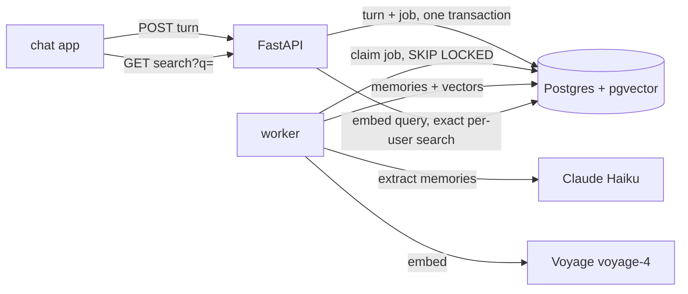

# smriti

**100% recall and 93% precision extracting memories from held-out Hinglish chats, at $0.00017 a message; search p99 40 ms at 100k memories.**

[](https://github.com/mahelikaa/smriti/actions/workflows/ci.yml)

Long-term memory for a chat companion that talks in Hinglish. Every message
goes in, a worker decides what is worth remembering, and the companion can
search those memories later. It also has to know what to forget: passing
moods, facts that stopped being true, and anything the user asks it to drop.

**Numbers**

| | |
|---|---|
| Extraction, 15 held-out Hinglish messages (Claude Haiku) | 100% recall, 93% precision |
| Extraction cost | $0.00017 per message |
| Search p99, 100k memories, heaviest user holds 10k | 40 ms |
| Search p99, typical user (100 memories) | 2 ms |
| Retrieval recall@5 / recall@1, 134 memories, 61 queries | 95% / 64% |

## How it works



1. `POST /v1/users/{id}/turns` stores the message and enqueues an extraction
   job in the same transaction. Retries with the same `external_id` are
   idempotent; a conflicting retry gets a 409.
2. The worker claims a job with `FOR UPDATE SKIP LOCKED` and a 60 s lease, so
   several workers never take the same job and a crashed worker's job is
   picked up again. Failures back off exponentially; after 8 attempts the job
   is marked dead.
3. Claude Haiku gets the message, the time it was sent (IST) and the user's
   related memories. It returns typed memories, which may supersede old ones
   ("moved to Bangalore" replaces "lives in Gurgaon").
4. Each memory is embedded with Voyage and stored. Search embeds the query and
   returns the closest live memories for that user.

## Remembering and forgetting

- **Skips small talk and passing moods.** "aaj bahut thak gayi hoon" saves
  nothing; "mujhe flying se dar lagta hai" does.
- **Resolves relative dates.** "parso flight hai", sent at 00:20 IST on
  23 Nov, becomes 25 Nov, not 24 (the UTC date is still the 22nd).
- **Supersedes instead of piling up.** An outdated memory gets `superseded_by`
  and drops out of search. A plan with an "if" supersedes nothing.
- **Doesn't guess.** The prompt forbids inferring gender, job or city from
  grammar ("office mein meeting thi" does not say where they work).
- **Forgets on request.** `DELETE /v1/users/{id}/memories/{mid}` deletes the
  memory and everything it replaced, and leaves a tombstone so a later GET
  returns 410, not 404. `DELETE /v1/users/{id}` removes the user's turns and
  memories.

## Design decisions

**Claude Haiku, not Opus.** On the 61-case dev set Opus reached 98% recall
against Haiku's 94% before prompt fixes, at 34× the cost per message. After
the fixes Haiku hits 100% on that set and on the held-out set, at $0.00017 a
message.

**No HNSW index.** At 100k memories a global HNSW index takes about 40
nearest neighbours and then filters by user. A typical user owns 0.1% of the
rows, so on average 0.06 rows came back and recall@5 was 1%. Iterative scan
fixed the row count but pushed p99 to 80 ms with 38% recall. A btree index on
`(user_id, embedding_model)` plus an exact sort is faster and exact, because
latency depends on how many memories one user has, not the table size.

**Postgres as the queue.** Jobs live next to the data, so a turn and its job
are committed together and there is no second system to run.

**Tests on a real database.** Tests run against a separate `smriti_test`
database built from the migrations, never the dev database. The Claude and
Voyage clients are faked, so CI needs no API keys.

## Known weaknesses

- **recall@1 is 64%.** With many similar memories (a sister's wedding and a
  cousin's engagement), the right one is in the top 5 but often not first.
  A reranker is the next thing to try.
- **Embeddings miss one-step reasoning.** "satay try karna hai" does not find
  "is allergic to peanuts".
- **The eval sets are small and written by one person.** The 61-case set was
  used to tune the prompt, so only the 15 held-out cases give an honest
  extraction number. Opus results are from before the last prompt change.
- **The held-out set has one disputed label.** "Hyderabad ki biryani ka koi
  muqabla nahi" was labelled as small talk; Haiku saved it as a food
  preference, which is arguably right.

## Run it

Needs Docker, an Anthropic key and a Voyage key.

```bash
cp .env.example .env   # add ANTHROPIC_API_KEY and VOYAGE_API_KEY
docker compose up -d --build
curl -X POST localhost:8000/v1/users/u1/turns -H 'content-type: application/json' \
  -d '{"external_id":"m1","role":"user","text":"main Pune shift ho gayi","sent_at":"2026-11-23T10:00:00+05:30"}'
curl 'localhost:8000/v1/users/u1/memories/search?q=where+do+i+live'
```

Postgres, the API (port 8000) and the worker start together; migrations run
on a fresh volume.

## Develop

```bash
docker compose up -d db
uv sync
uv run pytest
uv run --env-file .env python -m smriti.evaluate --runs 3
uv run --env-file .env python -m smriti.evaluate --cases eval/heldout.jsonl
uv run --env-file .env python -m smriti.retrieval
uv run python -m smriti.bench --sizes 10000 100000
```

| path | what |
|---|---|
| `src/smriti/main.py` | API |
| `src/smriti/worker.py`, `jobs.py` | job queue and worker |
| `src/smriti/extract.py` | Claude prompt and parsing |
| `src/smriti/embed.py`, `backfill.py` | Voyage embeddings |
| `src/smriti/evaluate.py`, `retrieval.py`, `bench.py` | evals and benchmark |
| `migrations/` | schema |
| `eval/` | cases and results |
